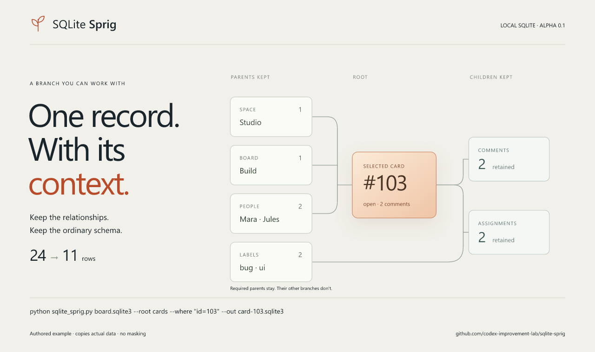

# SQLite Sprig

**Extract a SQLite branch. Keep the schema and parents it needs.**

An agent investigating one card, order or job often needs a usable database for that case. SQLite Sprig follows declared relationships, copies the selected rows, and retains ordinary tables, indexes, views, triggers and defaults in one local operation.



**Alpha · Python 3.11+ · SQLite 3.37+ · no third-party runtime dependencies.**

[Download the alpha and interactive example](https://github.com/codex-improvement-lab/sqlite-sprig/releases)

## First useful result

Clone this repository and run the standalone file, or install a wheel from [Releases](https://github.com/codex-improvement-lab/sqlite-sprig/releases).

```sh
python sqlite_sprig.py app.sqlite3 --root cards --where "id=103" --out card-103.sqlite3
```

After `python -m pip install ./sqlite_sprig-0.1.0a1-py3-none-any.whl`, the same operation is available as `sqlite-sprig` and `python -m sqlite_sprig`. The wheel has no runtime dependencies. This alpha is distributed through GitHub Releases; a PyPI release is not implied.

Try the included authored data without supplying a database:

```sh
python scripts/build_demo.py
python sqlite_sprig.py docs/data/board.sqlite3 --root cards --where "id=103" --out my-card.sqlite3
```

The example retains **11 of 24 rows**: one card, its two comments and two label assignments, plus the board, space, two people and two labels those records reference. Card 101 shares a reviewer and a label with card 103; it stays out of this result. The row count is not a file-size or speed claim.

Open `docs/index.html`, or unzip the `sqlite-sprig-demo.zip` release asset and open its `index.html`, to explore all three precomputed examples and download the actual SQLite files. The page uses authored data and makes no runtime network requests; it illustrates the CLI's results rather than processing an uploaded database. Links to GitHub navigate there when you choose them.

## Selection rules

1. Select rows matching `--where` in `--root`.
2. Follow child foreign keys recursively from those rows.
3. Add required parent rows recursively. Parents added here do **not** bring in all their other children.

Use `--parents-only` to skip step 2. Unselected ordinary tables remain in the result with no rows. Foreign keys must be declared in the source: Sprig cannot infer application-only relationships or decide whether a retained branch reproduces a bug.

The condition is a SQLite expression, evaluated on a read-only source connection. Choose a root that expresses the intended branch. Self-referential child trees can be large; `--max-rows 10000` and `--timeout 30` are the defaults. The time budget is cooperative, not a hard process-kill deadline.

## What is preserved

- Original ordinary table, index, view and trigger definitions, including defaults and constraints.
- Selected writable values and rowids; generated columns recompute from the original definition.
- AUTOINCREMENT sequences, `user_version` and `application_id`.
- Parent-key collation and affinity when following foreign keys, including composite keys, cycles and `WITHOUT ROWID` tables.

Triggers are installed **after** the rows load, so import does not replay their side effects. Sprig runs `foreign_key_check` and `integrity_check` before publishing the result. Definitions are retained; aggregate views, counts cached in rows and application invariants can still change meaning when other data is absent. Check the application behavior that matters to your case.

The output path must be unused and its directory must already exist. A same-directory hard link publishes the finished result without replacing an existing file, including a concurrent writer's destination. Filesystems that do not support this operation return an error. Interrupted extraction is not a general crash-recovery service.

## Agent interface

Successful extraction writes one JSON object to stdout and exits 0. Errors, including invalid arguments, write JSON and exit 2. `--help` and `--version` are human-readable. Example fields:

```json
{"format":"sqlite-sprig/1","status":"created","root":"cards","seedRows":1,"totalRows":11,"sourceReadOnly":true,"masked":false}
```

The full response includes the output path, per-table counts, bytes, version and process duration. No selected row contents are printed. `sourceReadOnly` describes how the connection is opened; it is not a source hash attestation. Foreign-key enforcement in a later SQLite connection still requires that caller to enable `PRAGMA foreign_keys=ON`.

```python
from pathlib import Path
from sqlite_sprig import extract

summary = extract(Path("app.sqlite3"), Path("case.sqlite3"), "cards", "id=103")
```

The API raises `SliceError`, `sqlite3.Error` or `OSError` for failed extraction. **This copies actual data. It does not mask, anonymize or authorize sharing it.**

## Current boundaries

This alpha handles ordinary local SQLite databases. It rejects virtual/shadow tables (including FTS), missing FK parents, no matching root rows, exceeded limits and tables that shadow every hidden rowid alias. It does not load extensions or custom collations, connect to database servers, preserve planner statistics/file layout, or find a minimal failing case. Unsupported schema features may produce a clear SQLite error. Query/view behavior still depends on the functions and data available in the extracted database.

## Why another option?

[Subsetter](https://github.com/msg555/subsetter) with a schema-first workflow and a short direct SQLite script both produced correct results in our authored comparison. Sprig packages the local branch-selection and schema-restoration workflow into a reusable call. It is useful when that operation repeats; it does not replace a carefully customized extraction script or a database masking service.

Two internal independent agents completed one frozen task correctly: the direct-script arm reported 107 seconds, the prototype arm 100 seconds. Both still inspected and validated the data. That tiny, prepared-environment trial **does not demonstrate net time savings or external adoption**. See [validation and limitations](docs/VALIDATION.md).

## Development

```sh
python -m unittest discover -s tests -v
python -m pip install build
python -m build
python scripts/smoke_package.py dist/sqlite_sprig-0.1.0a1-py3-none-any.whl
```

MIT. Built by Elias S. W. at Codex Improvement Lab. Specific selection or schema failures with an authored reproducer are welcome.
